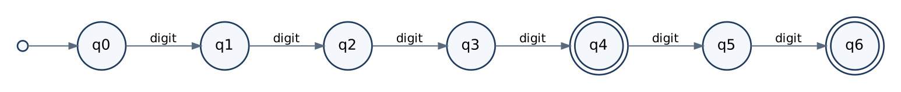
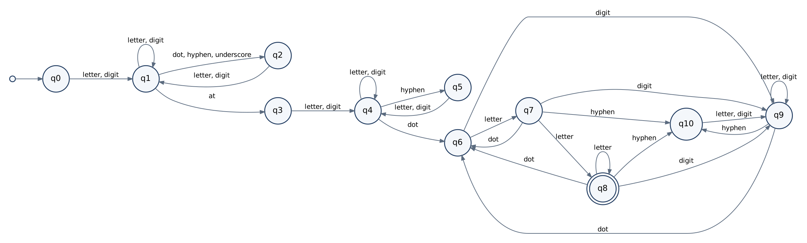
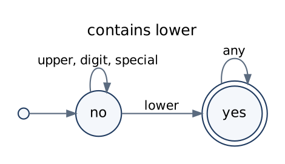
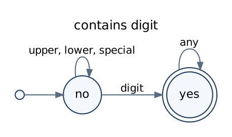
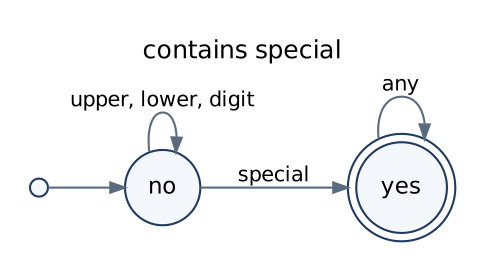
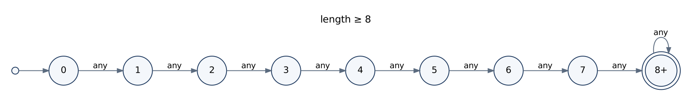

# Design Note – Designing Automata for Real-Time Applications

**Course:** 21CSC301T – Formal Language and Automata · **Assignment 2** · AY 2026–2027, Semester V
**Student:** `<Name>` · **Register No.:** `<Register Number>` · **Faculty:** Dr. C. Gunasundari

---

## 1. Objective

Design, implement and test deterministic finite automata (DFA) for three real-time
input-validation tasks: password format, email format and ATM PIN format. For each
one the note gives the problem, alphabet, language, rules, automaton, explanation of
states and transitions, test strings and limitations.

A DFA is a 5-tuple **M = (Q, Σ, δ, q₀, F)** where Q is a finite set of states, Σ the
input alphabet, δ : Q × Σ → Q the transition function, q₀ ∈ Q the start state and
F ⊆ Q the set of final states. M accepts w when δ̂(q₀, w) ∈ F, where δ̂ is δ extended
to strings [1, 2].

**Symbol classes.** Drawing one arrow per keyboard character is unreadable, so
characters that behave identically are grouped (all digits → `digit`, etc.). δ is
defined on the classes. This is notation only; replacing every class arrow by one
arrow per character gives an ordinary DFA.

**Trap state.** Every (state, symbol) pair that is not drawn goes to the trap state
`qd`, which is non-final and loops to itself on every symbol. This keeps δ total.

---

## 2. ATM PIN Verification (smallest automaton)

| Item | Definition |
|---|---|
| Problem | Check that the keyed-in PIN has a legal format before it is sent to the bank. |
| Alphabet | Σ = {0,…,9} ∪ {other}; `other` = every non-digit character |
| Language | L_pin = { w ∈ {0,…,9}* : \|w\| = 4 or \|w\| = 6 } |
| Regular expression | D⁴ + D⁶, D = (0+1+…+9) |
| Assumptions | Leading zeros allowed. Only the format is checked. |

**DFA.** M_pin = ({q0,…,q6,qd}, {digit, other}, δ, q0, {q4, q6})



| State | digit | other | Meaning |
|---|---|---|---|
| → q0 | q1 | qd | nothing read |
| q1 | q2 | qd | 1 digit read |
| q2 | q3 | qd | 2 digits read |
| q3 | q4 | qd | 3 digits read |
| * q4 | q5 | qd | 4 digits read – valid 4-digit PIN |
| q5 | q6 | qd | 5 digits read – invalid length |
| * q6 | qd | qd | 6 digits read – valid 6-digit PIN |
| qd | qd | qd | trap |

**Explanation of transitions.** The machine counts digits: each digit moves one state
to the right, so state qᵢ means "exactly i digits read". A non-digit from any state
goes to qd because no string containing a non-digit is in L_pin. A seventh digit takes
q6 to qd because no string longer than 6 is in L_pin. q4 and q6 are final because
those are exactly the two legal lengths; q5 sits between them and is not final, which
is how 5-digit input is rejected.

**Why an FA is enough.** The count never needs to exceed 6, so seven counting states
suffice.

---

## 3. Email Format Validator

**Problem.** Reject text that cannot be an email address (no @, no extension,
consecutive dots, …) at the moment it is typed.

**Alphabet.** Σ = {a–z, A–Z, 0–9, `.`, `-`, `_`, `@`} ∪ {other}, grouped as
`letter`, `digit`, `dot`, `hyphen`, `underscore`, `at`, `other`.

**Simplified grammar (assumption – this is not RFC 5322 [4]).**

```
email  → local @ domain
local  → word | word sep local            sep → . | _ | -
domain → label . tld | label . domain
label  → word | word - label
tld    → letter letter | letter tld
word   → alnum | alnum word
```

**Language.** L_email = L( W (S W)* @ W (- W)* ( . W (- W)* )* . A A⁺ ),
with W = (letter+digit)⁺, S = (. + _ + -), A = letter.

**Rules.** (1) local part starts and ends with a letter/digit; (2) separators `. _ -`
never appear twice in a row; (3) exactly one `@`; (4) domain labels are separated by
single dots and may contain single interior hyphens; (5) at least one dot in the
domain; (6) the extension is letters only, length ≥ 2.

**Not supported:** quoted local parts, `+` tags, comments, IP-literal domains,
non-ASCII addresses, length limits.

**DFA.** M_email = ({q0,…,q10,qd}, Σ, δ, q0, {q8})



| State | Meaning |
|---|---|
| q0 | Start |
| q1 | In local part, last character was a letter/digit |
| q2 | In local part, last character was a separator |
| q3 | Just read `@` |
| q4 | In first domain label, last character was a letter/digit |
| q5 | In first domain label, last character was a hyphen |
| q6 | Just read a dot in the domain |
| q7 | Label after a dot: exactly one letter so far |
| q8 | Label after a dot: two or more letters only – **final** |
| q9 | Label after a dot containing a digit or hyphen (sub-domain only) |
| q10 | Label after a dot, last character was a hyphen |
| qd | Trap |

**Explanation of every transition.**

| Transition | Reason |
|---|---|
| q0 –letter,digit→ q1 | The local part must begin with a letter or digit. |
| q1 –letter,digit→ q1 | Continue the current word. |
| q1 –dot,hyphen,underscore→ q2 | One separator is allowed after a letter/digit. |
| q2 –letter,digit→ q1 | A separator must be followed by a letter/digit. A second separator or `@` from q2 goes to qd (rules 1, 2). |
| q1 –at→ q3 | `@` ends the local part; only legal after a letter/digit. |
| q3 –letter,digit→ q4 | The domain must begin with a letter/digit. A second `@` goes to qd (rule 3). |
| q4 –letter,digit→ q4 | Continue the first label. |
| q4 –hyphen→ q5, q5 –letter,digit→ q4 | An interior hyphen must be followed by a letter/digit. |
| q4 –dot→ q6 | First dot of the domain. From now on a label might be the extension. |
| q6 –letter→ q7 | First letter of a possible extension. |
| q6 –digit→ q9 | A label starting with a digit cannot be the extension. |
| q7 –letter→ q8 | Second letter: the label is now a valid extension. |
| q8 –letter→ q8 | Longer extensions (com, info). |
| q7,q8 –digit→ q9 | A digit spoils the extension; the label is only a sub-domain now. |
| q7,q8,q9 –hyphen→ q10, q10 –letter,digit→ q9 | Hyphen inside a later label; a hyphenated label cannot be the extension. |
| q7,q8,q9 –dot→ q6 | The label turned out to be a sub-domain; a new label starts. |
| q9 –letter,digit→ q9 | Continue the sub-domain label. |

q8 is the only final state: the machine is in q8 exactly when all earlier rules held
and the text after the last dot is two or more letters.

**Verification.** The unit tests compare the DFA with the equivalent regular
expression on 100,000 random strings; they agree on every one.

---

## 4. Password Verification (product construction)

| Item | Definition |
|---|---|
| Problem | Enforce a password format policy at sign-up. |
| Alphabet | Σ = U ∪ L ∪ D ∪ S; U = {A–Z}, L = {a–z}, D = {0–9}, S = 32 ASCII punctuation characters. Everything else is `other`. |
| Language | L_pwd = { w ∈ Σ* : \|w\| ≥ 8, w contains a symbol from each of U, L, D, S } |
| Assumptions | No maximum length; order of characters is irrelevant; space is not allowed. |

**Design by product construction.** L_pwd = L_U ∩ L_L ∩ L_D ∩ L_S ∩ L_len, where
L_U = Σ\*UΣ\* (similarly L_L, L_D, L_S) and L_len = Σ⁸Σ\*. Each has a small DFA:

| Component | Diagram | States |
|---|---|---|
| contains uppercase |  | 2 |
| contains lowercase |  | 2 |
| contains digit |  | 2 |
| contains special |  | 2 |
| length ≥ 8 |  | 9 |

Regular languages are closed under intersection; the proof builds the **product
automaton** whose states are tuples of component states and whose final states are the
tuples in which every component is final [1, §4.2]. Here a product state is written
`ULDS|k`: a letter is shown when that class has been seen (`-` otherwise) and k is the
number of characters read, capped at `8+`.

- Start state: `----|0`
- Final state: `ULDS|8+` (all five components accept)
- Transition on a symbol of class c: switch flag c on, increase k (unless already 8+)
- `other` → qd

Of the 2·2·2·2·9 = 144 tuples only 104 are reachable (a state with j flags on needs at
least j characters, and every character turns a flag on): 1 + 4·8 + 6·7 + 4·6 + 1·5 = 104.
With the trap state, **|Q| = 105**. The complete table is in
[`transition_tables.md`](transition_tables.md) and the complete graph in
`diagrams/password_product_dfa.png`.

**Worked run** for `Ab1!xyzw`:
`----|0 →A U---|1 →b UL--|2 →1 ULD-|3 →! ULDS|4 →x ULDS|5 →y ULDS|6 →z ULDS|7 →w ULDS|8+` ✔

The application reads the "conditions satisfied / missing" list directly from the
state reached, which shows that the state really stores that information.

---

## 5. Test Strings

All strings below are run by `pytest` and by the **Test cases** tab of the app.
Actual results are in [`test_results.txt`](test_results.txt) (54 tests passed).

### Password
| Accepted | Rejected | Reason for rejection |
|---|---|---|
| `Secure@123` | `Ab1!` | too short |
| `Abcdef1!` | `password123!` | no uppercase |
| `P@ssw0rdLong` | `PASSWORD123!` | no lowercase |
| `9#xY7$kLm` | `Password!!` | no digit |
| `Srm_Trichy2026` | `Password123` | no special character |
| `aB3$aB3$aB3$` | `Pass word1!` | space is outside Σ |
| | ε | empty string |

### Email
| Accepted | Rejected | Reason for rejection |
|---|---|---|
| `student@srmist.edu.in` | `plainaddress` | no @ |
| `sai.vardhan@gmail.com` | `@gmail.com` | empty local part |
| `user_01@mail-server.org` | `user@gmail` | no extension |
| `a@b.co` | `user..name@gmail.com` | consecutive separators |
| `first-last@dept.university.ac.uk` | `user@gmail.c` | extension too short |
| `x9@123.info` | `user@@gmail.com` | two @ |
| | `user@gmail.c0m` | digit in extension |
| | `user name@gmail.com` | space |
| | `user@-gmail.com` | label starts with hyphen |
| | `user.@gmail.com` | local part ends with separator |

### ATM PIN
| Accepted | Rejected | Reason for rejection |
|---|---|---|
| `1234` | `123` | 3 digits |
| `0000` | `12345` | 5 digits |
| `987654` | `1234567` | 7 digits |
| `000042` | `12a4` | letter |
| `5081` | `12 34` | space |
| `314159` | `12#456` | special character |
| | ε | empty |

---

## 6. Syntax Validation versus Semantic / Business Rules

| Application | Decided by the DFA (syntax) | Needs additional processing (semantics) |
|---|---|---|
| Password | length, character classes | comparing with the stored hash (authentication), breached-password lists, password history, "must differ from username" |
| Email | shape `local@domain.ext` | does the domain exist (DNS), does the mailbox exist, does the user own it (confirmation mail) |
| ATM PIN | 4 or 6 digits | is it the right PIN for this card, attempt counter, account status |

**A finite automaton is sufficient** when the answer depends on a bounded summary of
the characters read so far (which classes appeared, a count up to a fixed limit, the
current position in a fixed pattern).

**Additional processing is needed** when the answer depends on data outside the string
(databases, networks), on state kept between attempts, or on unbounded memory.

---

## 7. Limitations of the Model

1. **No unbounded counting.** { aⁿbⁿ } and balanced brackets are not regular (pumping
   lemma [1, §4.1]); a stack is needed.
2. **No comparison with earlier input.** "Confirm password equals password" is the
   language { w#w }, which is not regular and not even context-free.
3. **No external knowledge.** The DFA sees only the string.
4. **No memory across runs.** "Three wrong attempts" needs a stored counter.
5. **State explosion.** Five trivial rules already need 105 product states; each extra
   yes/no rule doubles the count.
6. **Simplified email syntax.** Real addresses allowed by RFC 5322 (e.g. `a+b@x.org`,
   quoted strings) are rejected, and some syntactically valid addresses do not exist.
7. **Format ≠ strength.** `Password@1` satisfies the policy but is a weak password.

## 8. Design Comparison

| Design | Size for the password rule | Advantage | Drawback |
|---|---|---|---|
| Single product DFA | 105 states | one deterministic pass, one final state | cannot be drawn by hand; grows multiplicatively |
| Five component DFAs run in parallel | 17 states in total | each is trivial to draw and explain | "all accept" is decided outside the automata |
| NFA / regular expression | compact for Σ\*UΣ\* patterns | short to write | intersection still needed; simulation tracks state sets |

DFA and NFA have equal power (subset construction [1, §2.3]); the choice affects only
size and convenience. For the PIN and email rules a direct DFA is small and is the
natural choice.

## 9. Relevance to SDG 9

Correct input validation is a basic building block of reliable digital infrastructure
(banking terminals, registration services). Modelling the checks formally makes them
testable and predictable, which supports SDG 9 – Industry, Innovation and Infrastructure.

## 10. References

1. J. E. Hopcroft, R. Motwani and J. D. Ullman, *Introduction to Automata Theory, Languages, and Computation*, 3rd ed., Pearson, 2007.
2. M. Sipser, *Introduction to the Theory of Computation*, 3rd ed., Cengage Learning, 2013.
3. P. Linz, *An Introduction to Formal Languages and Automata*, 6th ed., Jones & Bartlett, 2017.
4. P. Resnick (ed.), "Internet Message Format," RFC 5322, IETF, 2008.
5. P. A. Grassi et al., *Digital Identity Guidelines: Authentication and Lifecycle Management*, NIST SP 800-63B, 2017.
6. Streamlit documentation, https://docs.streamlit.io · Graphviz documentation, https://graphviz.org/documentation/
